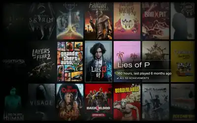

# Backlog

A screensaver for Steam Big Picture and the Steam Deck, made from your own game library. Your covers, your hours,
your achievements and the time, in four slow scenes. Nothing to sign in to, nothing sent anywhere, and it keeps
itself up to date.

[](https://glidian.dev/backlog/)

Mosaic, at real speed: one picture, then every tile turns over into the next. [See all four scenes playing](https://glidian.dev/backlog/).

**Steam Deck and Steam Big Picture · reads only Steam's own files on your device · free and open source (MIT)**

> [!NOTE]
> Backlog is fan-made and free. Game names, covers and art belong to their owners. It isn't affiliated with or
> endorsed by Valve or any game's publisher.

## The four scenes

Each one plays for five minutes, in a random order. Every so often a game steps into the spotlight with its name,
your hours, when you last played it and your achievements.

- **Mosaic.** Hundreds of small covers gather into one big picture: the art of one of your games. The camera
  holds back so the picture reads, then pushes in until you can see it was your library all along, and the tiles
  turn over into the next game.
- **Drift.** A tilted wall of covers that drifts past, lifting one out at a time.
- **Flip.** A flat board of covers that turns over like a departures board: one flap, a small ripple, now and
  then a wave across the whole board.
- **Ripple.** A grid of covers that a slow wave passes through, rising and dimming as it goes.


## Install

Download the latest zip from [Releases](../../releases/latest) and unzip it.

### Steam Deck

1. Switch to Desktop Mode (Steam button > Power > Switch to Desktop).
2. Unzip the download, open the folder and double-click **Install Backlog**. It asks three things: which scenes you
   want, how long each should stay, and what the clock in the corner shows. Then a window shows the install and a pop-up says it is done.
3. Go back to Game Mode, open Settings > Customization > Screensaver and pick **backlog**.

Changed your mind about the scenes, the timing or the clock? Double-click **Install Backlog** again and pick again.

**Updating:** download the new version, unzip it and double-click **Install Backlog** in the new folder (it may be
named `backlog 1` if your old download is still there). There is nothing to uninstall first and your settings are
kept. Afterwards you can delete the download folders, old and new.

Prefer a terminal? `sh ~/Downloads/backlog/tools/install.sh` does the same thing, with every scene on, five minutes
each. Add `--scenes mosaic,drift --minutes 10` to choose, and `--clock clock` or `--clock none` for less in the corner.

### Windows (Steam Big Picture)

In the unzipped folder, run:

```powershell
powershell -ExecutionPolicy Bypass -File tools\sync.ps1 -Install
```

Then open Big Picture mode (the setting is only there), and go to Settings > Customization > Screensaver > backlog.
Restart Steam if it isn't listed yet.

To pick which scenes play and for how long, add `-Scenes` and `-Minutes` (now or any time later):

```powershell
powershell -ExecutionPolicy Bypass -File tools\sync.ps1 -Install -Scenes mosaic,drift -Minutes 10
```

`-Clock` picks what the clock in the corner shows: `all`, `clock` (the time and date, without your games and
total hours) or `none`.

### Linux

`sh tools/install.sh`, then pick it in Steam's Big Picture mode the same way. It needs Python 3. `--scenes`,
`--minutes` and `--clock` work here too. The same script should work on a Mac, but I haven't been able to test one.

## It keeps itself up to date

Steam opens a screensaver as a plain page with no access to Steam itself, so Backlog can't look your games up while
it runs. The installer reads Steam's files on your device once (your games, playtime, achievements, cover art and
newest screenshots) and copies what it needs into the screensaver's folder.

On a Steam Deck (and other Linux systems with systemd) the installer also turns on a small background refresh:
every 15 minutes and after a restart, it re-reads those files so new games and hours show up on their own. A
refresh with nothing new takes about a second. On Windows, `tools\sync.ps1 -ScheduleDaily` refreshes at logon and
once a day.

## Settings

Open `config.js` in the installed folder (`<Steam>/config/uioverrides/screensavers/backlog/`) in any text editor.
Every line is explained there. The ones people change most:

| Setting | What it does |
|---|---|
| `scenes` | Which scenes play, and in what order: `mosaic`, `drift`, `flip`, `ripple`. The installer sets this for you. One more is included but off: `ripple2`, a deeper Ripple. |
| `minutesPerScene`, `shuffle` | How long each scene stays, and whether the order is random. |
| `clock` | 12 or 24 hour, and seconds. |
| `clock.show` | What the clock corner shows: `'all'`, `'clock'` (the time and date, without your games and total hours) or `'none'` (no clock). The installer sets this for you. |
| `featured` | Your favorites. The whole library still fills the scenes, but only these games take the spotlight and make Mosaic's pictures. |
| `library.exclude` | Games to never show, by name or app id. |
| `library.showHidden` | The games you hid in Steam are left out of Backlog too, screenshots included. Set it to `true` to show them anyway. |
| `library.minMinutes` | Skip games with less playtime than this. `1` shows only games you've played. |
| `library.merge` | Show several entries as one game with the hours added up. Entries with the same name join on their own. |
| `extraGames` | Games Steam doesn't know about, with your own art. |
| `oled` | Care for OLED screens: a slow pixel shift, dimming at night, and an optional fade to black. |

Reinstalling or updating keeps your `config.js`.

Non-Steam games are included when they have custom art or playtime. Art you set in Steam (for example from
SteamGridDB) is used as is.

## Privacy

- Nothing leaves your device. There is no account, no tracking and no network use.
- The installer only reads Steam's own files: your games, playtime, achievements, cover art and newest screenshots.
  [tools/README.md](tools/README.md) lists exactly which ones.
- One optional exception that you turn on yourself:
  [your own Steam Web API key](tools/README.md#optional-up-to-date-playtime-with-your-own-steam-web-api-key), for
  playtime from every device you play on. With it, Backlog asks Steam for your hours and nothing else.

## Uninstall

On a Steam Deck, double-click **Uninstall Backlog** in the download folder, or run
`python3 ~/.local/share/backlog/sync.py --uninstall`. It removes the screensaver and turns the background refresh
off. On Windows, run `tools\sync.ps1 -Unschedule` if you scheduled it, then delete
`<Steam>\config\uioverrides\screensavers\backlog`.

## Tested on

| Device | Notes |
|---|---|
| Steam Deck OLED (SteamOS, Game Mode) | A library of 127 games. Installed by double-click, picked scenes and minutes, ran as the screensaver, refreshed on its own, uninstalled and reinstalled |
| Windows 11 PC (Steam Big Picture) | Installed with `sync.ps1`, picked in Big Picture, ran as the screensaver |

If something looks off on yours, please open an issue. I'd especially like to hear how it does with a big library.

## Credits

- Fonts, all under the SIL Open Font License: [Archivo](https://fonts.google.com/specimen/Archivo),
  [Inter](https://fonts.google.com/specimen/Inter), [Barlow Condensed](https://fonts.google.com/specimen/Barlow+Condensed)
  and [Share Tech Mono](https://fonts.google.com/specimen/Share+Tech+Mono). Their license files are in `backlog/fonts/`.
- Every option of the install and sync tools is in [tools/README.md](tools/README.md).
- Made by Glidian. More projects at [glidian.dev](https://glidian.dev).

Game names, covers and art belong to their owners; Backlog isn't affiliated with or endorsed by Valve or any game's
publisher.

## License

MIT. See [LICENSE](LICENSE).

---

Made by [Glidian](https://glidian.dev). Also by Glidian: [Home Deck](https://github.com/glidiandev/home-deck) and
[KIDŌ](https://github.com/glidiandev/kido), two home screens for Android TV.
